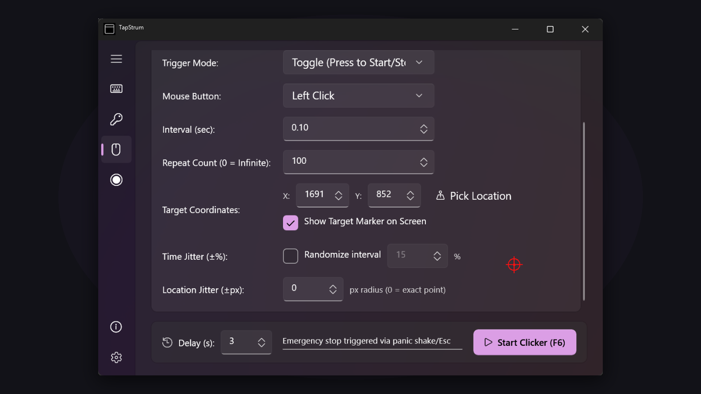

<div align="center">

<h1>TapStrum</h1>
<p>High-performance keyboard and mouse input automation utility suite for Windows 10 &amp; 11</p>
<p>
<a href="https://apps.microsoft.com/detail/9n4whn5np91c"></a>
<a href="LICENSE"></a>
<a href=".github/SECURITY.md"></a>
<a href="https://scorecard.dev/viewer/?url=github.com/Youchenjiang/TapStrum"></a>
</p>
<p>
<b>English</b> | <a href="README.zh-TW.md">繁體中文</a>
</p>


</div>

**TapStrum** is a modern, high-performance input automation utility suite engineered specifically for Windows 10 and Windows 11. It provides deterministic, microsecond-precision keyboard and mouse emulation directly on the desktop.

Most automation scripts and auto-clickers are either written in Python—paying a 1–2 second "cold start" overhead—or bundled with suspicious adware and bloated telemetry. TapStrum adopts a clean, native Windows architecture instead: a **Native Win32 driver engine** for zero-latency execution, a **WinUI 3 Fluent** dashboard with Mica material and 144Hz+ silky smooth interaction, and 100% local execution with zero network connectivity.

## Core Features

### Auto Typer
- **Keystroke Simulation** — Simulates physical keystrokes character-by-character with full Unicode UTF-16 direct injection.
- **Bypass Restrictions** — Seamlessly bypasses IME auto-completion interference and remote desktop / VNC clipboard limitations.
- **Execution Feedback** — Independent real-time progress indicators, adjustable typing intervals, and natural human-like jitter.

### Key Holder
- **Virtual Keyboard Grid** — Realistic 5-row physical virtual keyboard layout with real-time visual key activation glow.
- **Broad Key Capture** — Full 0x08–0xFE key capture support for complex shortcuts, function keys, and modifiers.
- **Continuous & Timed** — Toggle between infinite hold and precise countdown timers; supports multi-key rotational sequences.

### Auto Clicker
- **Ultra-Fast Clicking** — High-frequency mouse clicking supporting Left, Right, and Middle buttons down to millisecond intervals.
- **Crosshair Coordinate Picker** — Visual on-screen crosshair overlay to lock precise screen targets.
- **Randomized Jitter** — Configurable coordinate radius jitter and timing randomization to emulate human interaction.

### Macro Recorder
- **Low-Level Capture** — Global unmanaged input hooks record mouse clicks, movements, and keystrokes with QPC microsecond timestamps.
- **Variable-Speed Playback** — Replay recorded sequences with customizable speed multipliers (0.25x to 5.0x) and loop counters.
- **Step Visualizer** — Interactive step list for inspecting and pruning recorded action sequences.

### Windows 11 Fluent Dashboard & System Tray
- **Mica & Dark Mode** — Native Windows 11 Mica material backdrop, rounded corners, soft shadows, and dynamic Dark/Light theme switching.
- **System Tray Resident** — Minimizes cleanly to the Windows taskbar notification area upon closing or startup.
- **Global Wake-up Hotkey** — Instant foreground summoning from any application using **`Ctrl + Alt + T`**.
- **Always on Top** — One-click window pinning to float above target games or application windows.

### Local-First & Privacy
TapStrum is engineered on a strict **Local-First & Zero-Telemetry** philosophy:
- **100% Offline by Default**: Keystroke simulation, mouse clicking, coordinate detection, and macro recording run entirely locally via native Win32 APIs. Your data never leaves your computer.
- **Zero Telemetry**: No tracking SDKs, no analytics, no crash uploaders, and zero background telemetry daemons.
- **Input Security**: Never intercepts or logs background keystrokes when not actively engaged by the user. Configuration is stored strictly locally in `%LOCALAPPDATA%\TapStrum\settings.json`. See [PRIVACY.md](PRIVACY.md) for details.

## Installation

### Standalone Portable: Single-File EXE (Recommended)
1. Download `TapStrum.exe` from [Releases](../../releases).
2. Run directly — true single-file executable, zero installation, zero external dependencies, perfect for USB drives.

### Sideloadable Package: MSIX
Download `TapStrum-v1.4.0.0.msix` from [Releases](../../releases) to install with Windows modern app package management and desktop shortcuts.

### Microsoft Store (Official)
Get TapStrum directly from the [Microsoft Store](https://apps.microsoft.com/detail/9n4whn5np91c):

- One-click install and automatic background updates via the Microsoft Store.
- Verified and digitally signed by Microsoft with clean uninstall and package integrity protection.
- Self-contained trimmed runtime (~6.85 MB) requiring zero external .NET runtime installations.

### Uninstall
Open **Settings > Apps > Installed apps**, find **TapStrum**, and click **Uninstall**. Application files and local cache are cleanly removed by Windows.

## Local Development

### Requirements
- Windows 10 (20H2+) or Windows 11
- .NET 8.0 SDK (8.0.400+) or .NET 9.0 SDK
- Windows 10/11 SDK (Build 19041+)

### Build
```powershell
git clone https://github.com/Youchenjiang/TapStrum.git
cd TapStrum
dotnet build TapStrum.sln -c Release
```

### Test
```powershell
dotnet test TapStrum.sln -c Release
```

### Packaging Pipelines
```powershell
# 1. Build Standalone Portable Single-File EXE (publish/TapStrum.exe)
powershell -ExecutionPolicy Bypass -File scripts/build_portable.ps1

# 2. Build Self-Contained Signed Store MSIX (publish/TapStrum-v1.4.0.0.msix, ~6.85 MB)
powershell -ExecutionPolicy Bypass -File scripts/build_msix.ps1
```

Full environment setup and build details: [LOCAL_BUILD_NOTES.md](LOCAL_BUILD_NOTES.md)

## Contributing
Before opening a pull request, please review:
- [CONTRIBUTING.md](CONTRIBUTING.md) — Git workflow and strict Conventional Commit rules
- [LOCAL_BUILD_NOTES.md](LOCAL_BUILD_NOTES.md) — Build, packaging, and clean worker shutdown
- [docs/ARCHITECTURE.md](docs/ARCHITECTURE.md) — Core Win32 driver and WinUI 3 architecture
- [docs/ROADMAP.md](docs/ROADMAP.md) — Product roadmap and milestones
- [CHANGELOG.md](CHANGELOG.md) — Full version history

## License
Licensed under the [MIT License](LICENSE).

