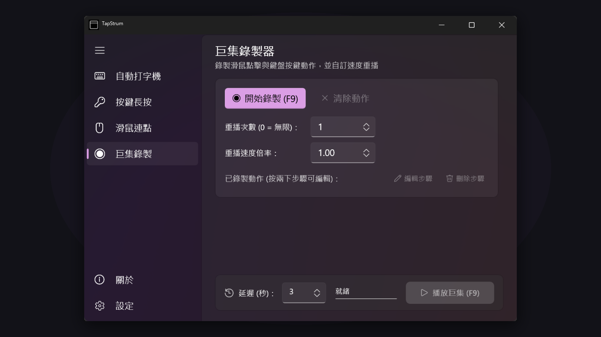

<div align="center">

<h1>TapStrum</h1>
<p>高效能的 Windows 10 / 11 鍵鼠自動化與輔助工具套件</p>
<p>
<a href="https://apps.microsoft.com/detail/9n4whn5np91c"></a>
<a href="LICENSE"></a>
<a href=".github/SECURITY.md"></a>
<a href="https://scorecard.dev/viewer/?url=github.com/Youchenjiang/TapStrum"></a>
</p>
<p>
<a href="README.md">English</a> | <b>繁體中文</b>
</p>


</div>

**TapStrum** 是一款專為 Windows 10 與 Windows 11 打造的高性能原生鍵鼠自動化輔助工具套件，為桌面環境提供確定性、微秒級精確度的鍵盤與滑鼠模擬控制。

坊間多數自動點擊器或自動化腳本大多以 Python 撰寫，每次啟動都需承擔 **1–2 秒的「冷啟動」延遲**，抑或充斥廣告與未知的遙測追蹤。TapStrum 採用純粹的 Windows 原生架構：**Native Win32 驅動引擎** 確保零延遲模擬響應、**WinUI 3 Fluent** 現代化 Mica 儀表板提供 144Hz+ 極速流暢拖曳與高質感介面，以及 100% 本機執行、絕無外部網路相依。

## 主要功能

### 自動打字機 (Auto Typer)
- **擬真實體鍵擊** — 以實體鍵擊事件逐字模擬輸入文字，支援 Unicode UTF-16 直投機制。
- **繞過輸入限制** — 自動繞過中英文輸入法組字干擾，並解決遠端桌面 (RDP / VNC) 或虛擬機剪貼簿限制。
- **即時執行反饋** — 具備獨立字元執行進度條、自訂打字間隔，以及模擬真人打字的自然隨機時間抖動。

### 按鍵長按器 (Key Holder)
- **實體虛擬鍵盤** — 內建 5 排標準物理鍵盤網格，長按與啟用狀態即時以視覺化發光呈現。
- **全鍵盤捕捉** — 完整支援 0x08–0xFE 鍵碼捕捉，包含功能鍵、修飾鍵與特殊控制鍵。
- **倒數計時與無限保持** — 支援精確秒數倒數或無限期按住；可自訂多組按鍵的時間輪替清單自動執行。

### 極速連點器 (Auto Clicker)
- **毫秒級超高頻連點** — 支援滑鼠左鍵、右鍵與中鍵連點，間隔精確微調至毫秒級。
- **十字準星取點** — 內建可拖曳螢幕十字準星取點工具，並可在畫面上標記鎖定座標。
- **座標與時間抖動** — 支援點擊半徑隨機位移與時間間隔隨機浮動，高度模擬真實點擊。

### 微秒級巨集錄製器 (Macro Recorder)
- **底層動作捕捉** — 透過全域 Win32 Low-Level 鉤子，以 QPC 高精度計時器捕捉滑鼠點擊、軌跡與鍵盤事件。
- **多倍速彈性回放** — 支援 0.25x 至 5.0x 多倍速自訂回放與重複執行次數。
- **視覺化步驟清單** — 即時檢視已錄製動作，雙擊可編輯步驟或清理動作。

### Windows 11 Fluent 儀表板與系統匣常駐
- **Mica 材質與深色主題** — 原生 Windows 11 Mica 半透明材質、圓角陰影與深淺色主題自適應。
- **系統匣常駐** — 關閉視窗或開機時自動縮小至工作列右下角系統匣常駐，不佔據工作列空間。
- **全域一鍵喚醒** — 在任何視窗隨時按下全域熱鍵 **`Ctrl + Alt + T`**，瞬間呼叫出主儀表板。
- **視窗永遠置頂** — 一鍵釘選視窗於最上層，方便一邊操作目標軟體或遊戲一邊監控狀態。

### 本機優先與隱私保護 (Local-First & Privacy)
TapStrum 秉持嚴格的 **本機優先（Local-First）** 與 **零遙測** 原則：
- **預設 100% 離線運作**：所有鍵盤按鍵模擬、滑鼠點擊、座標偵測與巨集錄製均完全在您的電腦本機執行，檔案與按鍵記錄絕不上傳伺服器。
- **零遙測與零追蹤**：無任何網路傳輸通訊、無分析追蹤 SDK、無背景常駐臃腫服務。
- **輸入安全保證**：未經使用者主動在前景操作時，絕不監聽或記錄任何背景按鍵。設定值僅儲存於本機 `%LOCALAPPDATA%\TapStrum\settings.json`。詳情請參閱 [PRIVACY.md](PRIVACY.md)。

## 安裝說明

### 綠色免安裝：單檔 EXE（推薦）
1. 從 [Releases](../../releases) 下載最新版 `TapStrum.exe`。
2. 雙擊直接開跑 — 真正的純單一檔案、零依賴、解壓即跑，非常適合隨身碟攜帶。

### 應用程式套件：MSIX
從 [Releases](../../releases) 下載 `TapStrum-v1.4.0.0.msix`，享受現代 Windows 應用程式封裝管理與桌面捷徑整合。

### Microsoft Store（官方微軟商店）
直接前往 [Microsoft Store 商店頁面](https://apps.microsoft.com/detail/9n4whn5np91c) 一鍵取得安裝：

- 微軟官方數位簽章認證、乾淨解除安裝與 MSIX 套件完整性保護。
- 透過微軟商店自動背景增量更新，永遠保持最新版本。
- **6.85 MB 極限瘦身自封裝架構**，無須在電腦上安裝額外的 .NET 執行階段。

### 解除安裝
開啟 Windows **設定 > 應用程式 > 安裝的應用程式**，搜尋 **TapStrum** 並點擊 **解除安裝**。Windows 將乾淨移除應用程式檔案與本機快取。

## 本機開發

### 環境需求
- Windows 10 (20H2+) 或 Windows 11
- .NET 8.0 SDK (8.0.400+) 或 .NET 9.0 SDK
- Windows 10/11 SDK (Build 19041+)

### 建置
```powershell
git clone https://github.com/Youchenjiang/TapStrum.git
cd TapStrum
dotnet build TapStrum.sln -c Release
```

### 測試
```powershell
dotnet test TapStrum.sln -c Release
```

### 打包腳本
```powershell
# 1. 打包純單檔綠色免安裝版 (publish/TapStrum.exe)
powershell -ExecutionPolicy Bypass -File scripts/build_portable.ps1

# 2. 打包自封裝 Store MSIX 套件 (publish/TapStrum-v1.4.0.0.msix, 6.85 MB)
powershell -ExecutionPolicy Bypass -File scripts/build_msix.ps1
```

完整環境配置與詳細建置指引：[LOCAL_BUILD_NOTES.md](LOCAL_BUILD_NOTES.md)

## 貢獻
發起 Pull Request 前，請參閱：
- [CONTRIBUTING.md](CONTRIBUTING.md) — Git 工作流程與嚴格 Conventional Commits 規範
- [LOCAL_BUILD_NOTES.md](LOCAL_BUILD_NOTES.md) — 建置、打包與乾淨編譯器關閉流程
- [docs/ARCHITECTURE.md](docs/ARCHITECTURE.md) — Win32 核心驅動與 WinUI 3 架構分析
- [docs/ROADMAP.md](docs/ROADMAP.md) — 產品發展藍圖與里程碑
- [CHANGELOG.md](CHANGELOG.md) — 完整版本歷史

## 授權條款
本專案採用 [MIT License](LICENSE) 授權條款開源發布。

